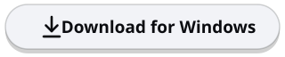
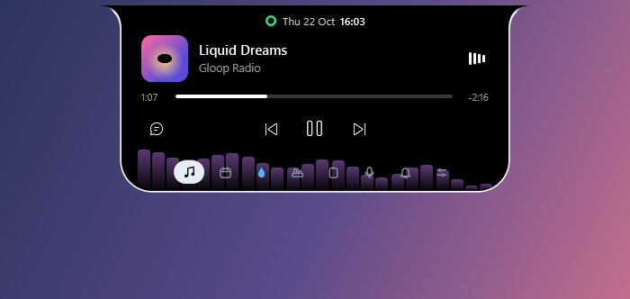
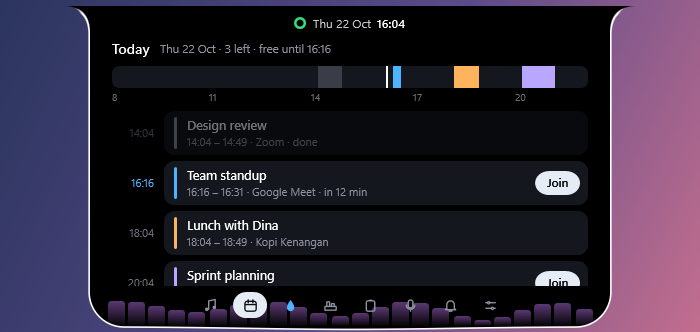
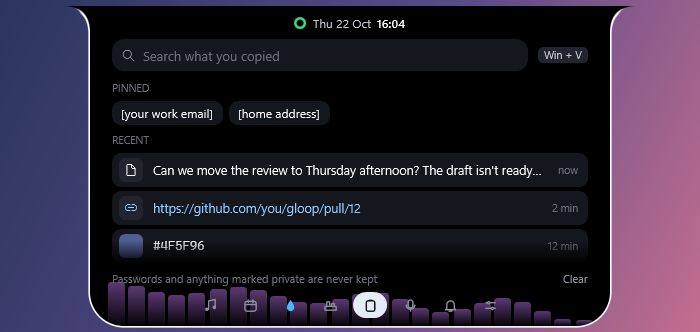
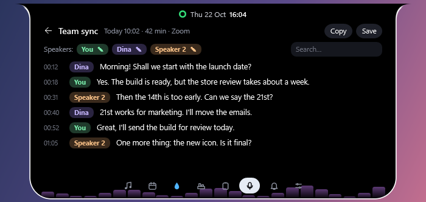
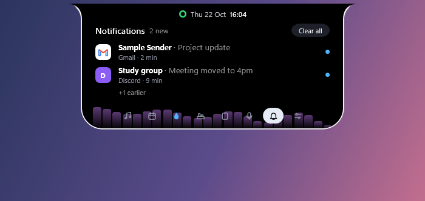
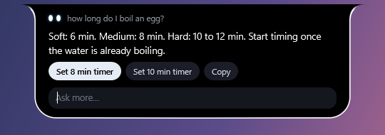

# Gloop

**A little liquid creature that lives in the notch at the top of your Windows screen.**

Music, your calendar, notifications, clipboard history and an AI assistant, one hover away.

## Get started

<table>
<tr>
<td width="33%" valign="top">

**1 · Download**

`Gloop-Setup.exe`, from the button above.

</td>
<td width="33%" valign="top">

**2 · Run it**

Pick a folder (your user folder is fine), then **Install**. No admin needed.

</td>
<td width="33%" valign="top">

**3 · Say hi**

Hover the notch at the top of your screen. He updates himself from now on.

</td>
</tr>
</table>

> **"Windows protected your PC"?** Gloop isn't code-signed yet, so SmartScreen may warn the first
> time. Click **More info › Run anyway**.

Needs Windows 10 (version 2004 or later) or Windows 11, 64-bit. Nothing else to install.

## What he does

<table>
<tr>
<td width="50%" valign="top">
 
<b>Music</b> 
Whatever's playing, in any app, with synced lyrics. He bounces to the beat and sings along.
</td>
<td width="50%" valign="top">
 
<b>Today</b> 
Your Google Calendar at a glance, with <b>Join</b> for Meet, Zoom and Teams calls.
</td>
</tr>
<tr>
<td valign="top">
 
<b>Clipboard</b> 
Everything you copied, searchable. Pin what you paste every day.
</td>
<td valign="top">
 
<b>Meeting notes</b> 
When a call starts he offers to write it down, with who said what, on your PC.
</td>
</tr>
<tr>
<td valign="top">
 
<b>Notifications</b> 
WhatsApp, Teams, Discord, your browser and Gmail slide out of the notch.
</td>
<td valign="top">
 
<b>Ask Gloop</b> 
An AI that opens apps, sets timers, plays music and looks at your screen.
</td>
</tr>
</table>

He also does water reminders, a shelf for files, a control center, battery and earbuds pop-ups,
and turns into a cat when you dock him on the taskbar.

## Shortcuts

| Press | To | Press | To |
|---|---|---|---|
| <kbd>Win</kbd> | Search your apps | <kbd>Win</kbd> <kbd>V</kbd> | Clipboard history |
| <kbd>Alt</kbd> <kbd>Tab</kbd> | Switch windows | <kbd>Win</kbd> <kbd>Space</kbd> | Ask Gloop |
| <kbd>Win</kbd> <kbd>Shift</kbd> <kbd>S</kbd> | Snip part of the screen | <kbd>Win</kbd> <kbd>M</kbd> | Gloop Music |
| <kbd>Win</kbd> <kbd>Shift</kbd> <kbd>R</kbd> | Record the screen (again to stop) | <kbd>Win</kbd> <kbd>Esc</kbd> | Lock with Gloop |
| <kbd>Alt</kbd> <kbd>F4</kbd> on the desktop | Shut down, restart, sleep, lock | Double-click him | Ask Gloop |

**Getting around:** hover or click the notch to open him, click the icons at the bottom (or
scroll) to switch pages, and drag him to any edge of the screen or leave him floating. Drop a
file on him to keep it on his Shelf. Right-click him for **Settings**, **Do not disturb** and
**Hide for 1 hour**.

Tap <kbd>Win</kbd> twice for the normal Start menu. Don't want one of these? **Settings ›
Features** turns any part of Gloop off.

## Works right away, or after a quick setup

<table>
<tr><th width="50%">Works right away</th><th width="50%">Connect it first</th></tr>
<tr>
<td valign="top">
Music from any player, with lyrics 
Clipboard history, Shelf, Water 
Notifications from your apps 
Control center, battery and devices 
Snips and screen recordings 
App launcher and window switcher
</td>
<td valign="top">
<b>Ask Gloop</b>: your own AI key (<a href="#set-things-up">how</a>) 
<b>Gmail and Calendar</b>: a free Google key (<a href="#set-things-up">how</a>) 
<b>Meeting notes</b>: a speech model, one download (<a href="#set-things-up">how</a>) 
<b>Taskbar buddy</b>: a Live2D character (<a href="#set-things-up">how</a>) 
<b>His own Spotify player</b>: Spicetify and the Gloop bridge
</td>
</tr>
</table>

## New lately

- **Gloop Music.** <kbd>Win</kbd> <kbd>M</kbd> (or double-click the lyrics) opens full-screen
  lyrics over the song's video or cover. With Spicetify, your Spotify library and playlists are
  there too.
- **Karaoke lyrics.** Lines light up word by word as they're sung, and pinned lyrics can drip out
  of his notch one word at a time.
- **Moods.** His face, glow and moves follow how the song feels, and his mouth sings along.
- **Lock with Gloop.** <kbd>Win</kbd> <kbd>Esc</kbd>: his goo pours down over the screen, then a
  calm away screen shows the time, the song and your next event (Settings › Look › Away screen).

<b>Older versions</b>

 

**1.13**

- **His own Spotify player.** With Spicetify and the Gloop bridge extension, Win + M brings out
  his own light player instead of Spotify's window: Now playing (like, shuffle, repeat, volume),
  Search, Up next and your Playlists. Spotify stays hidden and just plays.
- **Spotify in his pocket.** Win + M pops Spotify out of his notch in the middle of the dimmed
  screen; Win + M again, Esc or a click elsewhere slurps it back in, and it keeps playing hidden.
- **Live previews in Alt + Tab**, picked in Settings › Look & personality.
- **Alt + F4, Gloop style.** On the desktop his notch opens into a power menu; in an app he
  swallows the window as it closes.
- **A real setup** that asks where to install him, whether he starts with Windows and about a
  desktop shortcut.
- **Screen recording** with Win + Shift + R, sound included. The video lands in Videos › Screen
  Recordings and on the Shelf.
- **A snip toolbar:** Box, Window, Whole screen, and Photo or Video.
- **A taskbar buddy:** a Live2D character who sits in his puddle instead of the cat.

**1.4**

- **Alt + Tab, Gloop style:** your windows hang off his notch as drops.
- **Volume and brightness as his goo**, with Windows' grey pop-up out of the way.
- **Win + Shift + S bites out a snip**, ready to drag into a chat.
- **The Tide launcher:** he rises from the bottom of the screen with your apps bobbing on the wave.
- **Angry eyes**, a second look for him everywhere.
- **A new right-click menu** with Do not disturb and "Hide for 1 hour".

## Set things up

<b>Ask Gloop (the AI assistant)</b>

 

Gloop uses your own AI account, so you choose the service and nothing is shared with anyone else.

1. Right-click Gloop › **Settings › Ask Gloop**.
2. Pick a service and paste its key:
   - **Gemini**: free key at [aistudio.google.com/apikey](https://aistudio.google.com/apikey)
   - **Claude**: key at [console.anthropic.com](https://console.anthropic.com/)
   - **OpenAI**, or any OpenAI-compatible service (OpenRouter, Groq…): key from that service
   - **Ollama**: free and fully offline, using a model running on your own PC
3. Double-click Gloop and ask away.

Keys are stored encrypted for your Windows account.

<b>Gmail and Google Calendar</b>

 

Google asks every app that reads your mail or calendar to have its own key, so for now you
create a free one yourself. It takes about 5 minutes, once:

1. Go to [console.cloud.google.com](https://console.cloud.google.com/) and create a project.
2. **APIs & Services › Library**: turn on **Gmail API** and **Google Calendar API**.
3. **OAuth consent screen**: choose **External**, fill in the app name, and add your own Google
   address under **Test users**.
4. **Credentials › Create credentials › OAuth client ID** › **Desktop app**, then **Download
   JSON**.
5. In Gloop: **Settings › Pop-ups › Gmail › Connect**, pick that file, and sign in. Then
   **Settings › Calendar › Connect** (or the Today tab).

Google will say the app isn't verified, because it's your own; click **Continue**. Gloop only
asks to *read* your mail and calendar, and you can remove its access any time at
[myaccount.google.com/permissions](https://myaccount.google.com/permissions).

<b>Meeting notes</b>

 

1. Right-click Gloop › **Settings › Meetings**.
2. Choose **On this PC** and download a speech model once (**Fast**, about 200 MB, or **Better**,
   about 400 MB, which handles Indonesian well). Or choose **Gemini** to use your Gemini key.
3. When Zoom, Teams, Meet or Discord starts a call, Gloop asks if you want a transcript. Nothing
   is recorded unless you say yes. Please let the people on the call know.

Transcripts save to Word or text.

<b>Taskbar buddy (a Live2D character)</b>

 

Gloop doesn't come with a character; you bring one you like. Any Live2D (Cubism 3 or 4) model
works if it comes with the usual web player files, like the ones made for websites.

1. Right-click Gloop › **Settings › Look & personality › Taskbar buddy**.
2. Click **Get Firefly** to download her from her project,
   [Iskongkongyo/Firefly-live2d](https://github.com/Iskongkongyo/Firefly-live2d) (about 11 MB;
   she's fan-made, for personal, non-commercial use). Or **Add from file…** to use another Live2D
   model you have (a `.zip`, or its `.model3.json`).
3. Drag Gloop down onto the taskbar (with **Taskbar cat** on in Settings › Features). She sits
   in his puddle instead of the cat.

She lives in `Documents\Gloop\buddy`; **Remove** in the same place brings the cat back. Click her
to make her react, drag her to pick Gloop up, and use **Taskbar buddy size** in Settings › Look &
personality to make her bigger. She uses Microsoft Edge's WebView2, which Windows 11 already has;
on Windows 10, install the [WebView2 Runtime](https://developer.microsoft.com/microsoft-edge/webview2/)
if she doesn't appear.

<b>Other ways to install</b>

 

Prefer one click with no questions? `Gloop-win-Setup.exe` on the
[latest release](https://github.com/zannn1019/gloop-release/releases/latest) installs straight to
your user folder. Picking a protected folder like Program Files works too, but Windows will ask
for permission then, and for each update.

To uninstall: Windows Settings › Apps › Installed apps › **Gloop** › Uninstall.

## Privacy

<b>What Gloop keeps, and what it sends</b>

 

- **Hidden from screenshots and screen sharing** by default, so Gloop never shows up in your
  calls or captures (Settings › Privacy).
- **Clipboard history stays in memory** and disappears when Gloop closes. Only text you pin is
  saved. Copies that apps mark as private (passwords, codes) are never kept.
- **Meeting audio and transcripts stay on your PC**, unless you choose Gemini to transcribe.
- **API keys are encrypted** for your Windows account.
- **Song moods:** with Ask Gloop set up, only a song's title and artist go to your AI, once per
  song, so he can wear its mood. Turn off **Moods with the music** in Settings › Look to stop it.
- **Lyrics** are looked up on LRCLIB (or NetEase when LRCLIB has none) with the song's title,
  artist and length.
- **No accounts, no tracking, no analytics.** Gloop only talks to the services you connect.

## Questions

<b>Gloop disappeared when I opened a game or a video.</b>

 
That's on purpose: he hides while something is fullscreen, and comes back when it isn't. Turn
it off in Settings › General.

<b>Where did he go? I don't see him.</b>

 
If you chose <b>Hide for 1 hour</b>, right-click the tray icon › <b>Show Gloop again</b>. Or
right-click the tray icon › <b>Move back to the top</b>.

<b>He moved and I want him back at the top.</b>

 
Right-click him (or the tray icon) › <b>Move back to the top</b>.

<b>How do I get the normal Start menu back?</b>

 
Tap the Windows key twice, or turn off <b>App launcher</b> in Settings › Features.

<b>I want Windows' own Alt + Tab, volume pop-up or Snipping Tool back.</b>

 
Turn off <b>Window switcher</b>, <b>Volume & brightness</b> or <b>Snip</b> in Settings › Features.
Inside apps running as administrator (and some games), Windows keeps Alt + Tab for itself, so
you'll see its normal switcher there.

<b>Where do my screen recordings go?</b>

 
Videos › Screen Recordings, as MP4. The newest one is also on his Shelf.

<b>How do I check for updates?</b>

 
Gloop checks every few hours. To check now, click the version number at the bottom of Settings.

 

Found a bug or have an idea? [Open an issue](https://github.com/zannn1019/gloop-release/issues).

Made with care by [zannn1019](https://github.com/zannn1019).

