

# Gloop

**A little liquid creature that lives in the notch at the top of your Windows screen.**

Music, your calendar, notifications, clipboard history, meeting transcripts and an AI assistant,
one hover away, in a blob that wobbles, blinks and follows your cursor with its eyes.

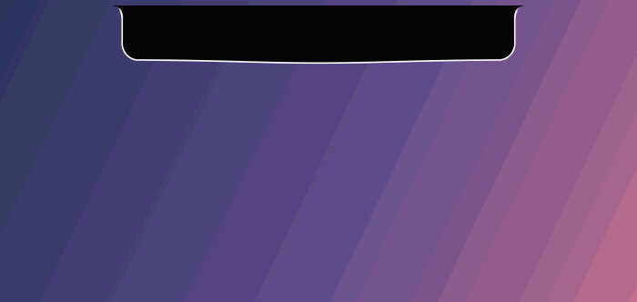

### [⬇ Download Gloop for Windows](https://github.com/zannn1019/gloop-release/releases/latest)

---

## What's new in 1.6

- **Screen recording.** Press **Win + Shift + R** (or pick Video in the snip toolbar), drag a box
  or take the whole screen, and after a 3-2-1 he records it, sound included. His notch shows a red
  dot and the time; hover it for Stop. The video lands in Videos › Screen Recordings and on the
  Shelf, ready to drag into a chat. Gloop keeps himself out of the recording.
- **A snip toolbar.** Win + Shift + S now stretches his notch into a bar: **Box**, **Window**
  (click a window to take just that), **Whole screen**, and **Photo** or **Video**. It remembers
  what you used last.
- **A taskbar buddy.** Put a Live2D character in `Documents\Gloop\buddy` and she sits in his
  puddle instead of the cat when he's docked on the taskbar: she watches your cursor, dozes off
  when you're away, sways to your music and reacts when you click her. Drag her to move him.
  See [Taskbar buddy](#setting-things-up) below.

<b>New in 1.4</b>

- **Alt + Tab, Gloop style.** Your open windows hang off his notch as drops; Tab moves a ring
  along them and he spits out the one you pick.
- **Volume and brightness as his goo.** The notch fills up to the level, and Windows' grey
  pop-up stays out of the way.
- **Win + Shift + S bites out a snip.** Drag a box and he slurps it up, ready to drag into a chat.
- **A new app launcher, "Tide".** He rises from the bottom of the screen with your apps bobbing
  on the wave. Open one and it tries to run away, until a volley of spikes drags it into the void.
- **Angry eyes.** A second look for him, everywhere he appears.
- **A new right-click menu** with Do not disturb and "Hide for 1 hour".
- **Fixed:** Gloop no longer vanishes behind maximized windows when your taskbar auto-hides.

---

## What it does

<table>
<tr>
<td width="50%" valign="top">

### 🎵 Music
What's playing in Spotify, YouTube, your browser or any player, with the cover, a progress bar
and controls. Gloop bounces to the beat and sings along with synced lyrics.

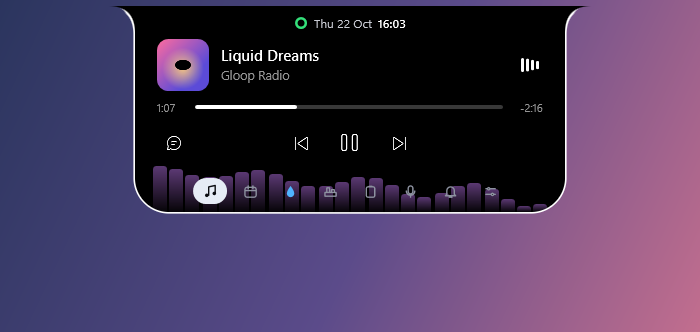

</td>
<td width="50%" valign="top">

### 📅 Today
Your Google Calendar at a glance: a strip of the day, what's next, and **Join** for Meet, Zoom
and Teams calls. A heads-up pops out a few minutes before each one.

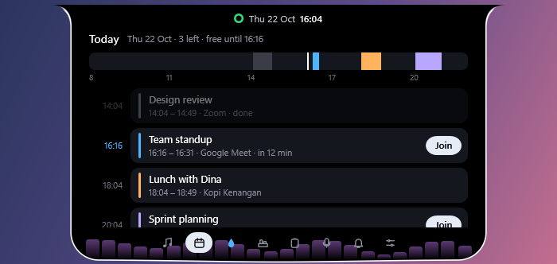

</td>
</tr>
<tr>
<td valign="top">

### 📋 Clipboard history
Everything you copy, searchable: text, links, colors, code, pictures and files. Pin the things
you paste every day. Opens with **Win + V**. Passwords from password managers are never kept.

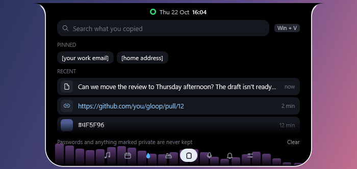

</td>
<td valign="top">

### 🎙️ Meeting transcripts
When a call starts, Gloop offers to write it down, with who said what. It runs on your PC (no
cloud needed), works with English and Indonesian, and saves to Word or text.

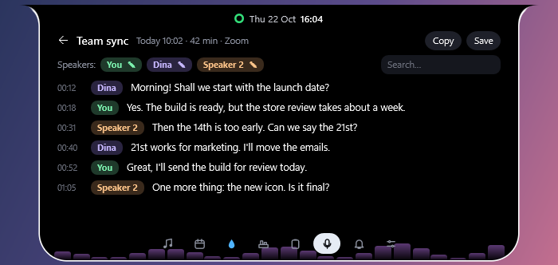

</td>
</tr>
<tr>
<td valign="top">

### 🔔 Notifications
Messages from WhatsApp, Teams, Discord, your browser and Gmail slide out of the notch, and
wait in the bell until you've seen them.

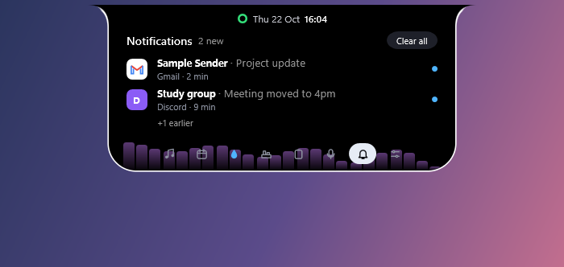

</td>
<td valign="top">

### 💧 Water, Shelf and more
Water reminders, a shelf to drop files on and drag them out later, screenshots you can drag
straight into a chat, a control center, battery and earbuds pop-ups, and a cat (or a Live2D
buddy of your own) when you dock him on the taskbar.

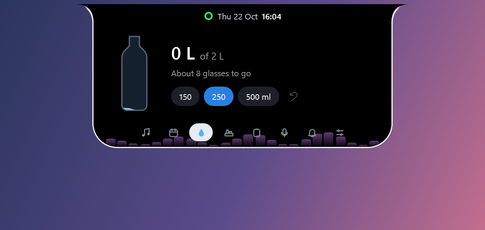

</td>
</tr>
</table>

### ✨ Ask Gloop
Double-click him (or press **Win + Space**) and ask anything. He can open apps, set timers, turn
on Do not disturb, control your music, read your recent notifications and look at your screen.
Works with Claude, Gemini, OpenAI or a model on your own PC.

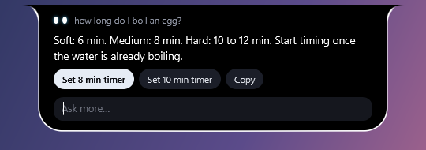

### 🚀 App launcher
Tap the **Windows** key on its own to search your apps, in one of three styles (Settings › Look):

- **Panel**: a search box that drips down from the notch, with a tab for your open windows.
- **Tide**: he rises from the bottom of the screen and your apps bob on the wave as drops. Type to
  search and the best match floats up. Open one and it makes a run for it, until a volley of
  spikes skewers it and drags it into the void.
- **Orbit**: your apps circle around him.

### 🪟 Windows, Gloop style
Three bits of Windows he takes over, each with its own switch in **Settings › Features**:

- **Alt + Tab**: hold Alt and his notch spreads into a band with your open windows hanging off it.
  Tab (or the arrow keys) moves the ring, his eyes follow it, and letting go of Alt brings that
  window to the front. Shift + Tab goes back, Esc cancels.

  

- **Volume and brightness**: the volume keys widen the notch and fill it with his goo up to the
  level. Muting drains it. Windows' own grey pop-up is hidden while this is on.
- **Win + Shift + S**: the screen freezes and dims, and his notch stretches into a toolbar: Box,
  Window, Whole screen, then Photo or Video. Drag a box (or click a window) and he bites it out.
  The snip is copied, saved to Pictures › Screenshots, and waits on the notch to be dragged into
  a chat or marked up.
- **Win + Shift + R**: the same, ready to record. A red edge and a 3-2-1 go round the area, then
  it records (with your PC's sound; turn that off with **Recording sound** in Settings ›
  Features). Hover the red dot on the notch and press **Stop**, or press Win + Shift + R again.
  The MP4 goes to Videos › Screen Recordings and onto the Shelf.

  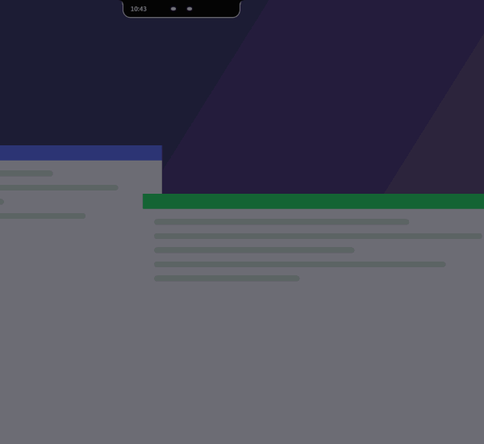

### 😠 Normal or angry
His eyes come in two styles: soft and round, or sharp and frowning (Settings › Look › Eyes).
The angry look follows him everywhere: the notch, the launcher, the music face.

### Pop-ups that stay out of your way

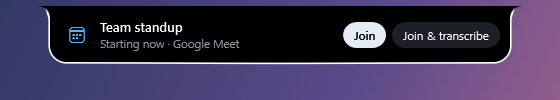 
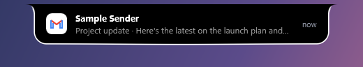 
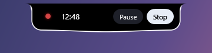

---

## Install

1. **[Download `Gloop-win-Setup.exe`](https://github.com/zannn1019/gloop-release/releases/latest)** from the latest release.
2. Run it. Gloop installs just for you (no admin needed), appears at the top of your screen and
   starts with Windows from now on.
3. That's it. Gloop updates itself when a new version comes out.

> **"Windows protected your PC"?** Gloop isn't code-signed yet, so Windows SmartScreen may warn
> about it the first time. Click **More info › Run anyway**.

**Needs:** Windows 10 (version 2004 or later) or Windows 11, 64-bit. Nothing else to install.

---

## Getting started

| To… | Do this |
|---|---|
| Open him | Hover over or click the notch |
| Switch pages | Click the icons at the bottom, or scroll |
| Ask Gloop | Double-click him, or press **Win + Space** |
| Clipboard history | **Win + V** |
| Search apps | Tap the **Windows** key on its own (tap it twice for the normal Start menu) |
| Switch windows | **Alt + Tab** (hold Alt, press Tab, let go) |
| Snip part of the screen | **Win + Shift + S** |
| Record the screen | **Win + Shift + R** (again to stop) |
| Move him | Drag him anywhere: glue him to any edge, or leave him floating |
| Keep a file for later | Drop it on him (it goes on the Shelf) |
| Quiet him for a while | Right-click him › **Do not disturb**, or **Hide for 1 hour** |
| Settings | Right-click him (or the tray icon) › **Settings** |

Don't need something? **Settings › Features** turns any part of Gloop off.

---

## Setting things up

<b>Ask Gloop (the AI assistant)</b>

 

Gloop uses your own AI account, so you choose the service and nothing is shared with anyone else.

1. Right-click Gloop › **Settings › Ask Gloop**.
2. Pick a service and paste its key:
   - **Gemini**: free key at [aistudio.google.com/apikey](https://aistudio.google.com/apikey)
   - **Claude**: key at [console.anthropic.com](https://console.anthropic.com/)
   - **OpenAI**, or any OpenAI-compatible service (OpenRouter, Groq…): key from that service
   - **Ollama**: free and fully offline, using a model running on your own PC
3. Double-click Gloop and ask away.

Keys are stored encrypted for your Windows account.

<b>Meeting transcripts</b>

 

1. Right-click Gloop › **Settings › Meetings**.
2. Choose **On this PC** and download a speech model once (**Fast**, about 200 MB, or **Better**,
   about 400 MB, which handles Indonesian well). Or choose **Gemini** to use your Gemini key.
3. When Zoom, Teams, Meet or Discord starts a call, Gloop asks if you want a transcript. Nothing
   is recorded unless you say yes. Please let the people on the call know.

<b>Gmail and Google Calendar</b>

 

Google asks every app that reads your mail or calendar to have its own key, so for now you
create a free one yourself. It takes about 5 minutes, once:

1. Go to [console.cloud.google.com](https://console.cloud.google.com/) and create a project.
2. **APIs & Services › Library**: turn on **Gmail API** and **Google Calendar API**.
3. **OAuth consent screen**: choose **External**, fill in the app name, and add your own Google
   address under **Test users**.
4. **Credentials › Create credentials › OAuth client ID** › **Desktop app**, then **Download
   JSON**.
5. In Gloop: **Settings › Pop-ups › Gmail › Connect**, pick that file, and sign in. Then
   **Settings › Calendar › Connect** (or the Today tab).

Google will say the app isn't verified, because it's your own; click **Continue**. Gloop only
asks to *read* your mail and calendar, and you can remove its access any time at
[myaccount.google.com/permissions](https://myaccount.google.com/permissions).

<b>Taskbar buddy (a Live2D character)</b>

 

Gloop doesn't come with a character; you bring one you like. Any Live2D (Cubism 3 or 4) model
works if it comes with the usual web player files, like the ones made for websites.

1. Download a model. For example, the Firefly one from
   [Iskongkongyo/Firefly-live2d](https://github.com/Iskongkongyo/Firefly-live2d): **Code ›
   Download ZIP**. (It's for personal, non-commercial use; please respect its license.)
2. Unzip it into `Documents\Gloop\buddy`, so you have `Documents\Gloop\buddy\Firefly-live2d\`
   with its `model` and `load` folders inside.
3. Drag Gloop down onto the taskbar (with **Taskbar cat** on in Settings › Features). She sits
   in his puddle instead of the cat.

Click her to make her react, drag her to pick Gloop up. She uses Microsoft Edge's WebView2, which
Windows 11 already has; on Windows 10, install the
[WebView2 Runtime](https://developer.microsoft.com/microsoft-edge/webview2/) if she doesn't
appear. To go back to the cat, remove the `buddy` folder.

---

## Privacy

- **Hidden from screenshots and screen sharing** by default, so Gloop never shows up in your
  calls or captures (Settings › Privacy).
- **Clipboard history stays in memory** and disappears when Gloop closes. Only text you pin is
  saved. Copies that apps mark as private (passwords, codes) are never kept.
- **Meeting audio and transcripts stay on your PC**, unless you choose Gemini to transcribe.
- **API keys are encrypted** for your Windows account.
- **No accounts, no tracking, no analytics.** Gloop only talks to the services you connect.

---

## Questions

<b>Gloop disappeared when I opened a game or a video.</b>

 
That's on purpose: he hides while something is fullscreen, and comes back when it isn't. Turn
it off in Settings › General. (Maximized windows don't count, even with an auto-hiding taskbar;
if he hid behind one before 1.4, update.)

<b>Where did he go? I don't see him.</b>

 
If you chose <b>Hide for 1 hour</b>, right-click the tray icon › <b>Show Gloop again</b>. Or
right-click the tray icon › <b>Move back to the top</b>.

<b>How do I get the normal Start menu back?</b>

 
Tap the Windows key twice, or turn off <b>App launcher</b> in Settings › Features.

<b>I want Windows' own Alt + Tab, volume pop-up or Snipping Tool back.</b>

 
Turn off <b>Window switcher</b>, <b>Volume & brightness</b> or <b>Snip</b> in Settings › Features.
Inside apps running as administrator (and some games), Windows keeps Alt + Tab for itself, so
you'll see its normal switcher there.

<b>Where do my screen recordings go?</b>

 
Videos › Screen Recordings, as MP4. The newest one is also on his Shelf. Win + Shift + R starts
and stops recording; Windows' Snipping Tool recorder comes back if you turn off <b>Snip</b> in
Settings › Features.

<b>He moved and I want him back at the top.</b>

 
Right-click him (or the tray icon) › <b>Move back to the top</b>.

<b>How do I check for updates?</b>

 
Gloop checks every few hours. To check now, click the version number at the bottom of Settings.

<b>How do I uninstall it?</b>

 
Windows Settings › Apps › Installed apps › <b>Gloop</b> › Uninstall.

---

Found a bug or have an idea? [Open an issue](https://github.com/zannn1019/gloop-release/issues).

Made with care by [zannn1019](https://github.com/zannn1019).

